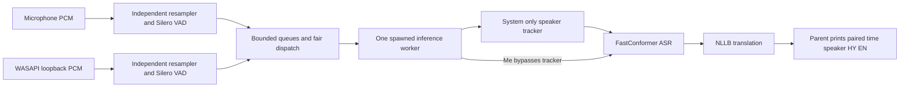

# Live Armenian transcription and English translation

A local Python terminal application for the Mathrix AI Coding Challenge. It captures
microphone and Windows system audio concurrently, transcribes Armenian, translates
it into English, and prints time, speaker, HY and EN together.

**Submission status, 1 November 2026:** the author chose the current experimental
speaker-matching mode after a real-call trial. This is a working prototype with
known speaker errors and frequent `Unknown` labels. The strict requirement of
at most 5 seconds from the actual end of speech to English output is **not
certified**. Choosing this snapshot for submission does not establish that every
challenge criterion has passed.

## Set up

Tested on Windows 11 x64, Python 3.13.5, Poetry 2, Intel i5-13420H and 16 GB RAM,
CPU only. The project requires Python >=3.13,<3.14. The live system-audio backend
is Windows WASAPI; macOS/Linux capture has not been implemented or tested.

From the repository root, create the project environment and prepare local models:

```powershell
poetry install
poetry run python scripts/download_asr.py
poetry run python scripts/download_translation.py
poetry run python scripts/download_vad.py
poetry run python -m scripts.prepare_diarization --models
```

Initial setup needs internet access and space for the model caches, including
NLLB's weights. Model preparation is separate from inference. Subsequent inference
uses prepared local artifacts; it does not call cloud speech/translation APIs,
download on failure, or switch to another model. No API key is required.

Poetry uses the project-local `.venv/` and the official CPU PyTorch wheel source.
Exact dependency versions are in `poetry.lock`. The speaker preparation helper also
prepares TitaNet for comparison; live inference loads only CAMPPlus.

## Select the audio devices

Connect the intended headphones before listing devices:

```powershell
poetry run python -m armenian_speech.combined --list-devices
```

The two printed lists have **separate numbering systems**:

- `--microphone-device`: a sounddevice input ID. Everything captured here is `Me`.
- `--device`: a PyAudioWPatch loopback ID. Select the output in which the call is
  actually heard. The program captures all sound on that endpoint, not one app.

The last checked setup on this laptop was:

| Device | ID | Format / purpose |
| --- | ---: | --- |
| Built-in Microphone Array, WASAPI | 14 | 48 kHz; selected microphone |
| OnePlus Buds 3 loopback | 16 | System sound when the call plays in the Buds |
| Realtek Speakers loopback | 17 | Alternative when the call plays through Realtek |
| OnePlus Buds 3 microphone, WASAPI | 15 | 16 kHz; use only if deliberately selecting the headset mic |

IDs change when devices are connected/disconnected. Earlier IDs 9/10 in development
records are historical. Make sure Windows permits microphone access, and select
the same output in the call application as the chosen loopback. There is no
automatic device switching. Headphones help avoid the microphone hearing playback;
echo cancellation and acoustic deduplication are outside this implementation.

## Run the selected submission configuration

For the current built-in microphone + Buds setup:

```powershell
poetry run python -m armenian_speech.combined --microphone-device 14 --device 16 --diarize --experimental-speaker-matching
```

For Realtek playback, replace `--device 16` with `--device 17`. If deliberately using
the headset microphone, use `--microphone-device 15 --microphone-rate 16000` instead.
Check current IDs first; these numbers are examples from this laptop.

Wait for `Combined live active`, then speak Armenian. Output is paired:

```text
[00:01:12] Speaker 1  HY: Բարև, ինչպե՞ս ես։  EN: Hi, how are you?
[00:01:15] Me  HY: Լավ եմ, շնորհակալություն։  EN: I'm fine, thank you.
```

This is an illustrative format, not a claimed recording or evaluation result.
Press **Ctrl+C** once to close capture and finish accepted work. Wait for
`Both sources closed; finishing accepted phrases...`. A second interrupt or the
shutdown deadline can terminate unfinished work. Python's normal Ctrl+C exit is
130; Poetry's parent may report 1 on this Windows setup.

The selected command is quiet: startup, paired output and actionable warnings.
For per-cell numeric reasons/scores and a final capture summary, add
`--speaker-diagnostics`. It does not turn on periodic source levels. The broader
`--diagnostics` flag also enables periodic status/timing output.

### Speaker modes

| Flags on the combined command | Behavior |
| --- | --- |
| No `--diarize` | Existing `Me` / `System` source labels |
| `--diarize` | First Stage 4.2 speaker rules retained for comparison |
| `--diarize --experimental-speaker-matching` | Selected submission trial; still experimental |

The trial can register a new voice from a 1.5–<2 s cell when two overlapping
one-second views from that same cell agree. It may retain an existing ID when
full-window and both separate half-window matches agree on that ID despite low
half-to-half similarity; this exception never trains the centroid. It does not
accumulate audio between replies, hide `Unknown`, or force a two-person limit.
IDs are session-local, with a default capacity of eight and no recycling.

Replies below 1.5 s cannot create a new ID even in the trial; those below 1 s
cannot produce an embedding. Unknown speech still reaches ASR/translation, subject
to the existing live text-fragment guard. Detailed rules and adverse results:
[SPEAKER_MATCHING_TRIAL.md](SPEAKER_MATCHING_TRIAL.md).

### Other entry points

```powershell
# Microphone only, no system-speaker identification
poetry run python -m armenian_speech.microphone --device 14 --sample-rate 48000 --live

# System audio only
poetry run python -m armenian_speech.system_audio --device 16 --live --diarize --experimental-speaker-matching

# Original offline WAV path: mono PCM16, 16 kHz
poetry run armenian-speech --wav "C:\path\to\armenian.wav" --offline
```

For other flags, run the corresponding command with `--help`. There is no
`--min-audio-ms` option in this version.

## Models and reasons for choosing them

| Component | Selected model / runtime | Reason and alternatives |
| --- | --- | --- |
| Armenian ASR | [Vana-Labs FastConformer](https://huggingface.co/Vana-Labs/stt-fastconformer-armenian), RNN-T INT8, greedy, ONNX Runtime CPU | On the same 15 Armenian read-speech WAVs, ASR WER 6.67%, CER 2.03%; substantially better than the rejected Whisper Base baseline. No NeMo or CUDA needed. |
| HY to EN | [NLLB-200 distilled 600M](https://huggingface.co/facebook/nllb-200-distilled-600M), CPU float32, greedy | Reference-text chrF++ 57.86 versus Marian 32.88 and M2M100 39.61. A beam-2 experiment was slower and scored lower, so greedy was retained. |
| Speech activity | Silero VAD 6.2.3 ONNX, one CPU thread | Runs with the existing ONNX Runtime; explicit streaming state and separately verified local artifact. No TorchAudio dependency. |
| Speaker embedding | CAMPPlus ONNX via Sherpa-ONNX 2.0.1, one CPU thread | Similar results to TitaNet Small on the small clean-English experiment, lower standalone sampled RSS (about 128 vs 169 MiB). Short inputs and call-channel changes remain unreliable. |

ASR revision: `ec92cef52199c3874681321b13853e8fe602d23f`.
NLLB revision: `f8d333a098d19b4fd9a8b18f94170487ad3f821d`.
The local download helpers/provenance pin revisions/checksums; runtime checks
prepared artifacts. NLLB uses `hye_Armn` -> `eng_Latn`, `num_beams=1`, no sampling.
Its model is published under CC-BY-NC 4.0; this research prototype is not a claim
of commercial model licensing. Silero is MIT; retain upstream model notices and
review all model terms before reuse. The code repository does not redistribute weights.

These ASR/translation scores are small-sample historical measurements, not live
conversation accuracy. Comparisons and provenance are in
[ASR_COMPARISON.md](ASR_COMPARISON.md),
[TRANSLATION_COMPARISON.md](TRANSLATION_COMPARISON.md), and
[DIARIZATION_COMPARISON.md](DIARIZATION_COMPARISON.md).

## Architecture



Capture callbacks only copy/count PCM into bounded raw queues. The main process
resamples to mono PCM16 16 kHz and runs separate VAD states. VAD prefers a short
pause after 3.5 s and caps segments at 6 s. Per-source pending queues alternate
before one worker, which loads ASR/MT/speaker models once before opening capture.
System PCM is divided into nonoverlapping 2 s cells for speaker decisions; adjacent
equal labels are combined before ASR. `Me` never enters the speaker tracker.

Default limits are 32 raw blocks per source, two pending phrases per source and
at most two admitted worker jobs including the active one. Overflow drops incoming
work with counters/warnings. A split source job consumes one fairness credit until
its last part; sequential ASR/MT calls cannot be preempted. Output follows dispatch,
not a global ordering by speech timestamp. Ctrl+C drains accepted work within a
shared deadline, then accounts for anything unfinished.

Source responsibilities: `combined.py` orchestrates both inputs, `microphone.py`
and `system_audio.py` capture, `live_vad.py`/`loopback_vad.py` convert and segment,
`fair_queue.py` schedules, `speakers.py` matches voices, `live_pipeline.py` owns the
spawn worker, `asr_onnx.py` and `translation.py` wrap the models, `output.py` formats.
The original `pipeline.py`/`cli.py` WAV path remains separate.

## Evidence and known limitations

- **Latency:** the strict <=5 s physical speech-end requirement is unconfirmed.
  A six-second audio cap does not bound end-to-end latency. Translation/queue
  backlogs have exceeded 5 s in earlier tests. The latest call's maximum
  VAD-decision-to-output was 1.886 s, which excludes speech-to-VAD delay and is not
  a physical end-to-end result. Microphone ADC clock anomalies remain unvalidated.
- **Speaker identity:** the latest 67.6 s call completed 12/12 jobs with two discovered
  IDs and no registered raw/phrase losses, but 8/14 System parts were Unknown.
  Counts are printed parts, not DER or speaker accuracy. Late enrollment, duplicate
  IDs under channel changes and wrong matches remain possible. The trial accepted
  a synthetic overlap control and produced extra IDs in a synthetic band-change
  control. This is why the flag still says experimental.
- **Recognition/translation:** Armenian names, conversational speech, fragments and
  English terms inside Armenian can be wrong. English translation can change or
  invent meaning. There is no confidence-based correctness guarantee. Shorter VAD
  cuts increased WER on the existing set from 6.67% to 11.67% in a separate segmented
  comparison; this does not replace the full-WAV score.
- **Boundaries/overlap:** two-second speaker cells are coarse and may cut words or
  contain multiple people. No overlap detector, separation or word alignment is
  implemented. Similarity scores are not probabilities. Short replies can be Unknown.
- **Audio routing:** device IDs and endpoint routing must be checked on the actual
  laptop. The program does not isolate one application's output or switch devices
  automatically. Echo handling is out of scope.
- **Retention:** normal inference saves no permanent recording or transcript file.
  ASR uses a short-lived WAV in `.cache/live/session-*`, removed after processing
  and on controlled cleanup; an OS crash may leave a temporary file. Optional
  research reports retain numeric data. Public evaluation fixtures/model caches
  stay local and are ignored by Git.

With more time, priorities would be independently annotated Armenian multi-person
calls and physical latency validation; stronger speaker segmentation/overlap handling
and channel-robust matching; preserving ASR context across speaker boundaries;
and CPU translation/backlog optimization. Known failures would remain in the
comparison set rather than tuning only for the demonstrated clips.

## Validate and inspect the evidence

```powershell
poetry run python -m pytest -q -p no:cacheprovider --basetemp .cache/pytest-submission
poetry run ruff check .
poetry check
```

Use `python -m pytest`, not the standalone entry point, because tests import the
repository's `scripts` and `tests` namespace modules. Explicit `--basetemp` avoids
the sandbox's Windows Temp permission issue. Tests check mechanics and regressions;
they do not certify conversation quality. See [TESTS.md](TESTS.md) for actual runs.

Optional public read-speech reproduction (preparation refuses to overwrite data):

```powershell
poetry run python scripts/prepare_samples.py
poetry run armenian-speech --manifest data/local/fleurs/manifest.jsonl --offline --report reports/wav_pipeline.json
```

Run model benchmarks sequentially. Most research probes require already prepared
ignored fixtures under `data/local/`; some also require the local baseline copy
not distributed in the repository. See each script's `--help`/docstring and the
linked experiment protocol before running it. The application itself requires
only the prepared model files, not evaluation audio or numeric reports.

## Delivery and development history

Public repository and publication checks: [PUBLICATION.md](PUBLICATION.md).

[SUBMISSION_CHECKLIST.md](SUBMISSION_CHECKLIST.md) maps the brief to implementation,
evidence and outstanding delivery steps. [DEMO_GUIDE.md](DEMO_GUIDE.md) is the laptop
rehearsal/code walkthrough. Historical decisions and tests remain in
[DECISIONS.md](DECISIONS.md) and [TESTS.md](TESTS.md). The previous long development
README is preserved as [DEVELOPMENT_HISTORY.md](DEVELOPMENT_HISTORY.md); its device
IDs and stage descriptions are historical. Latest working context:
[CURRENT_HANDOVER.md](CURRENT_HANDOVER.md).

`chats/` contains Markdown exports sourced from the saved Codex session records,
one file per actual project conversation; automated internal review sessions are excluded. Message bodies are not
summarized or rewritten. `EXPORT_MANIFEST.json` records source/export hashes and
snapshot counts. Refresh before submission because this chat is still active:

```powershell
poetry run python -m scripts.export_project_chats
```

Keep the original conversations available in Codex for the interview. The local
export covers saved sessions whose working directory is this project; it cannot
prove the absence of additional work in other accounts/machines/directories.
Repository: [Amin71518/armenian-speech-translator](https://github.com/Amin71518/armenian-speech-translator).
Final chat refresh and source publication require the author-approved commit step. Model weights, audio, caches, reports and credentials
must stay out of that repository. No model/API keys are required by inference.
